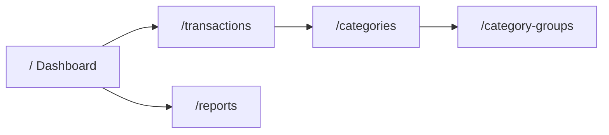

# Budget Tracker Webapp

## Stack
- Next.js (App Router) with TypeScript, scaffolded with `create-next-app` in the current folder, [/Users/steve.chui/Development/BudgetApp](/Users/steve.chui/Development/BudgetApp)
- Tailwind CSS for styling, and shadcn/ui for forms, tables, and dialogs
- Prisma with SQLite, stored in a file at `prisma/dev.db`
- Zod to validate input, Recharts for charts, and date-fns to group dates into periods
- Server Actions handle saving changes. Server components read from the database directly.
- No login: the app is for one user running it locally.

## Data model (`prisma/schema.prisma`)

```prisma
enum CategoryType { CREDIT DEBIT TRANSFER }
enum Direction    { CREDIT DEBIT }

model CategoryGroup {
  id         Int        @id @default(autoincrement())
  name       String     @unique
  categories Category[]
}

model Category {
  id           Int           @id @default(autoincrement())
  name         String        @unique
  type         CategoryType
  groupId      Int
  group        CategoryGroup @relation(fields: [groupId], references: [id], onDelete: Restrict)
  transactions Transaction[]
}

model Transaction {
  id          Int       @id @default(autoincrement())
  date        DateTime
  description String
  amountCents Int       // always positive; sign comes from direction
  direction   Direction
  categoryId  Int
  category    Category  @relation(fields: [categoryId], references: [id], onDelete: Restrict)
  createdAt   DateTime  @default(now())
}
```

Amounts are stored as whole cents so that totals don't pick up floating-point rounding errors.

**How transactions count toward the budget:**
- A category's type decides which total its transactions count toward. Transactions in TRANSFER categories are left out of all totals.
- A transaction's credit/debit direction decides whether its amount is added or subtracted:
  - **Income** is credits minus debits, counting only transactions in CREDIT categories.
  - **Expense** is debits minus credits, counting only transactions in DEBIT categories. This way, a refund reduces spending.
  - **Net** is income minus expense.

**Deletion rules:**
- A category that has transactions can't be deleted. The UI shows how many transactions use it and lets you reassign them to another category, which then allows the delete.
- A group that still contains categories can't be deleted.

## Seed data (`prisma/seed.ts`)

Each group is listed with its categories and their type:
- **Income** (credit): Salary, Bonus, Interest, Dividends, Freelance, Refunds & Reimbursements, Other Income
- **Housing** (debit): Rent/Mortgage, Property Tax, Home Insurance, Maintenance & Repairs, HOA Fees
- **Utilities** (debit): Electricity, Gas/Heating, Water & Sewer, Internet, Mobile Phone, Trash
- **Food** (debit): Groceries, Dining Out, Coffee
- **Transportation** (debit): Fuel, Public Transit, Parking & Tolls, Auto Insurance, Car Maintenance, Rideshare
- **Health** (debit): Health Insurance, Doctor & Dental, Pharmacy, Fitness
- **Personal & Shopping** (debit): Clothing, Personal Care, Household Supplies, Electronics, Gifts
- **Entertainment** (debit): Streaming & Subscriptions, Movies & Events, Hobbies, Travel
- **Financial** (debit): Bank Fees, Loan Payments, Taxes, Childcare & Education, Charity
- **Transfers** (transfer): Credit Card Payment, Account Transfer, Savings Contribution, Investment Contribution

There's also an optional `seed:demo` script that adds about 6 months of sample transactions, so the charts show something right away.

## Pages and routes



- `app/page.tsx` is the dashboard. It shows this month's income, expense, and net totals, a small monthly trend chart, and recent transactions.
- `app/transactions/page.tsx` is a table with filters for date range, category, group, and direction, plus a text search. Adding or editing a transaction happens in a dialog with fields for date, description, amount, direction, and category. Editing a transaction's category can be done inline from a dropdown in the table, or in the edit dialog.
- `app/categories/page.tsx` lists categories with full CRUD. Each category has a name, a type, and a group chosen from a dropdown. The list can be grouped or filtered by group.
- `app/category-groups/page.tsx` lists groups with full CRUD and shows how many categories each group has.
- `app/reports/page.tsx` has:
  - A selector for the period (Weekly, Monthly, or Quarterly) and for the date range.
  - A selector for what to show: Income, Expense, or both.
  - A bar chart of income against expense for each period, with a net line on top.
  - A stacked bar chart of expense by category group for each period.
  - A pie chart breaking down the selected range by category, which you can expand into individual categories within a group.

## Code layout
- `lib/db.ts` holds a single shared Prisma client.
- `lib/validation.ts` holds the Zod schemas for transactions, categories, and groups.
- `lib/actions/{transactions,categories,groups}.ts` hold the Server Actions for create, update, and delete. Each one calls `revalidatePath` so pages refresh after a change.
- `lib/reports.ts` defines `getSeries({ period, from, to, groupBy })`. It fetches transactions with their categories, skips transfers, and groups them into periods using `startOfWeek`, `startOfMonth`, or `startOfQuarter` from date-fns. Periods with no data are filled with zeros so the charts have no gaps.
- `components/` holds reusable pieces: `TransactionForm`, `CategoryForm`, `GroupForm`, `ConfirmDelete`, `Money`, and the chart components (client components that use Recharts).

## Verification
- Run `npx prisma migrate dev` and the seed script, then `npm run dev`. Test each CRUD flow by hand, including the deletion rules.
- Add a few Vitest unit tests for `lib/reports.ts` that check period grouping, that transfers are left out, and that refunds are handled correctly.
