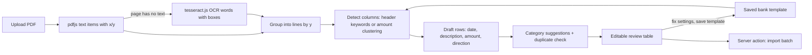

# PDF Bank Statement Import

## Text layer vs. image parsing (your question)
Most bank statements you download are "digital" PDFs: they contain a real text layer, and every word has exact coordinates. Reading that layer with `pdfjs-dist` is faster and more accurate than turning the page into an image and running OCR, because there's no chance of misreading characters like `8`/`B` or `1`/`l`. With the coordinates, we can rebuild table rows (by grouping words with the same y position) and columns (by x position).

Image parsing (OCR with `tesseract.js`) is only better for **scanned** statements. So the plan is to use the text layer first and run OCR automatically on any page that has no text. Both run locally in the browser, so nothing leaves your machine.

## Flow



Parsing happens in the browser, so the only thing sent to the server is the final JSON rows. This also avoids the 1MB default body limit on Server Actions (see `node_modules/next/dist/docs/01-app/03-api-reference/05-config/01-next-config-js/serverActions.md`).

## Data model additions ([prisma/schema.prisma](prisma/schema.prisma))

```prisma
model StatementTemplate {
  id          Int      @id @default(autoincrement())
  name        String   @unique      // e.g. "Chase Checking"
  fingerprint String                // text that identifies the bank, e.g. "JPMorgan Chase Bank"
  config      String                // JSON: column roles/x-ranges, date format, sign mode, skip patterns
  updatedAt   DateTime @updatedAt
}

model ImportBatch {
  id           Int           @id @default(autoincrement())
  fileName     String
  createdAt    DateTime      @default(now())
  transactions Transaction[]
}

// Transaction gains:
//   importBatchId Int?
//   importBatch   ImportBatch? @relation(fields: [importBatchId], references: [id], onDelete: SetNull)
```

`ImportBatch` lets you undo an entire import in one step.

## Parsing library (`lib/import/`, pure TypeScript, unit-tested)
- `types.ts` defines the core shapes: `TextItem { str, x, y, w, page }`, `Line`, `DraftRow { date, description, amount, direction, sourceLine, warnings[] }`, and `TemplateConfig`.
- `extract-pdf.ts` (client only) uses `pdfjs-dist` to call `getTextContent()` on each page and return a list of `TextItem`. If a page has no text items, it renders the page to a canvas and runs `tesseract.js` on it, mapping each recognised word's bounding box to a `TextItem`. Tesseract is lazy-loaded, and its English language data is stored in `public/tesseract/` so OCR works offline.
- `lines.ts` groups items into lines using a y-position tolerance, then sorts each line by x.
- `columns.ts` finds the column layout in two ways:
  - It looks for a header line containing words like Date, Description, Withdrawals/Debit, Deposits/Credit, Amount, or Balance, and uses their x positions as the columns.
  - If there's no header, it groups the right edges of money-shaped tokens to locate the amount columns.
- `rows.ts` turns lines into draft rows:
  - A line that starts with a date begins a new row.
  - A following line with no date and no amount is treated as a wrapped description and appended to the row above.
  - Dates are read in several formats (`MM/DD`, `MM/DD/YYYY`, `DD MMM`, `Jan 5`). When a date has no year, it's inferred from the statement period text, which handles statements that span December and January.
  - Amounts are read in several styles: `1,234.56`, `(12.00)`, `-12.00`, `12.00 CR`.
  - Direction comes from either separate debit/credit columns or a single signed amount column, depending on the sign mode.
- `reconcile.ts` checks the totals when the statement shows opening and closing balances, or a balance column: opening + credits − debits should equal closing. If it doesn't, the review screen shows how far off it is, which is a strong hint that a row was missed or misread.
- `template.ts` picks a saved template by searching the PDF text for its fingerprint, then applies the template's settings on top of the auto-detected ones.
- `suggest.ts` suggests categories:
  - It normalises descriptions by lowercasing them and removing digits, dates, card numbers, and store numbers.
  - It finds the category most recently used for the same normalised description. If there's no exact match, it falls back to the best word overlap with past transactions.
  - Suggestions are limited to categories that fit the row's direction: debit rows get DEBIT or TRANSFER categories, and credit rows get CREDIT or TRANSFER categories.
- Vitest tests go in `lib/import/*.test.ts`. They use fixture `TextItem` arrays instead of real PDFs and cover line grouping, wrapped descriptions, the different amount and date formats, year rollover, debit/credit columns versus signed amounts, and reconciliation.

## Server side
- `lib/actions/import.ts`:
  - `getImportContext()` returns the categories, the templates, and a history map of normalised description to category for suggestions.
  - `findPossibleDuplicates(from, to)` returns existing transactions in the statement's date range. The client matches them on date, amount, and direction, plus how similar the descriptions are.
  - `importTransactions({ fileName, rows })` validates every row with the existing `transactionSchema` from [lib/validation.ts](lib/validation.ts). It then creates an `ImportBatch` and all the transactions inside one `db.$transaction`, calls `revalidateAll()`, and returns the count.
  - `saveTemplate(...)` creates a template, `updateTemplate(...)` changes one, and `deleteTemplate(...)` removes it.
  - `undoImport(batchId)` deletes a batch along with its transactions.
- Add an `importRowSchema` (a row with an `include` flag) and a template config schema to [lib/validation.ts](lib/validation.ts).

## Review page (`app/import/page.tsx` plus client components)
1. **Upload.** Drag and drop a PDF, or pick a file. The page shows parsing progress and labels each page "Text layer" or "OCR". It reports any template it matched automatically, and a dropdown lets you choose a different one.
2. **Extraction settings panel.** This is where you "suggest" fixes to the parser:
   - Set the role of each detected column (Date, Description, Debit, Credit, Amount, Balance, or Ignore).
   - Set the date format, the sign mode (signed amount, separate debit/credit columns, or "CR" suffix), and a "flip direction" toggle.
   - Add skip patterns, such as "Daily balance" or "Page x of y".
   - Every change re-parses instantly in the browser.
   - **Save as template** stores these settings with a fingerprint so the next statement from that bank parses correctly right away.
3. **Raw lines view** (toggle). Shows every extracted line, marked as parsed, merged, or skipped. You can force a skipped line to become a row, or skip a whole category of similar lines, which adds a skip pattern.
4. **Editable table** (`components/import-review-table.tsx`):
   - Each row has an include checkbox and editable date, description, amount, direction, and category fields. The category uses the existing [components/category-select.tsx](components/category-select.tsx).
   - Suggested categories are marked with a "suggested" badge. Suspected duplicates are flagged and unchecked by default. Validation errors are shown on each row.
   - You can add a row manually, delete a row, set the category on all selected rows at once, and filter to show only rows with problems.
   - A summary bar shows the included count, total debits and credits, and the reconciliation status.
5. **Submit.** Calls `importTransactions`, shows a toast through `sonner`, and redirects to `/transactions`. The toast includes an Undo button that calls `undoImport`.
- Add an "Import" link to `LINKS` in [components/nav.tsx](components/nav.tsx). An "Import history" section on the page lists past batches, each with an undo option.

## Dependencies and config
- Install `pdfjs-dist` and `tesseract.js`.
- Set up the pdfjs worker with `new URL("pdfjs-dist/build/pdf.worker.min.mjs", import.meta.url)`. Check this against the Next 16 / Turbopack docs in `node_modules/next/dist/docs/` before wiring it up.
- Copy `eng.traineddata` and the tesseract worker/core files into `public/tesseract/` so OCR never fetches from a CDN.

## Verification
- Run `npm test` for the parser unit tests.
- Test by hand with one digital statement and one scanned statement (or a PDF exported as images):
  - Fix a column role, save it as a template, re-upload the statement, and confirm the template is picked up automatically.
  - Submit, confirm the transactions appear and reports update, then undo the batch.
