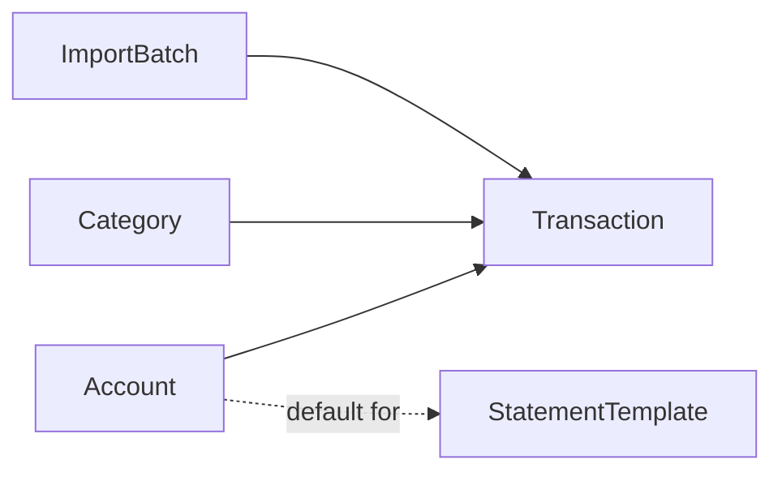

# Accounts on Transactions

## Data model ([prisma/schema.prisma](prisma/schema.prisma))

```prisma
enum AccountType { CHECKING SAVINGS CREDIT_CARD CASH INVESTMENT OTHER }

model Account {
  id                  Int                 @id @default(autoincrement())
  name                String              @unique   // "Wells Fargo Checking"
  institution         String?                       // "Wells Fargo"
  type                AccountType
  /// Signed; credit cards start negative when money is owed
  openingBalanceCents Int                 @default(0)
  transactions        Transaction[]
  templates           StatementTemplate[]
  createdAt           DateTime            @default(now())
}

// Transaction gains (required):
//   accountId Int
//   account   Account @relation(fields: [accountId], references: [id], onDelete: Restrict)
//   @@index([accountId])
// StatementTemplate gains (optional):
//   accountId Int?
//   account   Account? @relation(fields: [accountId], references: [id], onDelete: SetNull)
```

**Balance** = opening balance + credits − debits, counting every transaction in the account, transfers included. A credit card balance is therefore negative while money is owed, and a payment (a credit on the card account) brings it toward zero. Income and expense totals in reports are unchanged: transfers between your own accounts stay excluded.

**Migration with backfill:**
- Generate the migration with `prisma migrate dev --create-only --name accounts`.
- Edit the SQL before applying it. SQLite rebuilds the Transaction table, and the new required `accountId` would otherwise fail on the 193 existing rows. The edited SQL should:
  - insert `Account(id 1, name 'Main Account', type CHECKING)`;
  - fill `accountId = 1` when copying rows into the rebuilt Transaction table.
- Then apply it. You can rename "Main Account" afterwards, or move its transactions to other accounts.



## Seeds
- [prisma/seed.ts](prisma/seed.ts) also upserts one default "Main Account". This keeps fresh databases and the Playwright `e2e.db` usable. The edit only appends; it leaves your uncommitted category changes alone.
- [prisma/seed-demo.ts](prisma/seed-demo.ts) creates two accounts, "Checking" and "Credit Card". It puts card spending on the card account and records the card payment as a transfer out of Checking and into the card, so the demo balances look realistic.

## Server
- [lib/validation.ts](lib/validation.ts):
  - add `accountSchema` (name, optional institution, type, and an opening balance as a signed decimal string);
  - add `accountId` to `transactionSchema`, which also covers import rows;
  - add an optional `accountId` to `templateSchema`.
- New `lib/actions/accounts.ts` provides create, update and `deleteAccount(id, reassignToId?)`. Deletion follows the existing category pattern in [lib/actions/categories.ts](lib/actions/categories.ts): an account that still has transactions can't be deleted until you choose an account to move them to.
- [lib/queries.ts](lib/queries.ts):
  - `getAccounts()` returns each account with its transaction count and current balance. The balance is computed with one `groupBy` on `accountId` and `direction`, summing `amountCents`, then added to the opening balance.
  - `getTransactions` gains an `accountId` filter and includes the account in its results.
  - `getImportContext` also returns accounts, and each template's `accountId`.
- [lib/actions/transactions.ts](lib/actions/transactions.ts) needs no logic change, because `accountId` comes through the schema.
- [lib/actions/import.ts](lib/actions/import.ts): `importTransactions` takes one `accountId` that applies to every row in the batch. `saveTemplate` and `updateTemplate` store the template's `accountId`.

## UI
- **New `/accounts` page** (`app/accounts/page.tsx` plus `components/account-form.tsx` and `components/accounts-table.tsx`):
  - Accounts are grouped by type. Each row shows the institution, transaction count and current balance.
  - A summary at the top shows the total of all balances (net worth, with credit card debt counting as negative).
  - Add and edit happen in a dialog. Deleting an account that has transactions uses the same move-transactions-first dialog as categories.
  - Clicking an account opens `/transactions?account=ID`.
- **Shared `components/account-select.tsx`**: a simple Select, since the list is short, with the same props pattern as `CategorySelect`.
- **Transactions:**
  - [components/transaction-form.tsx](components/transaction-form.tsx) gets a required account field. For new transactions it defaults to the account used last, remembered in `localStorage`.
  - [components/transactions-table.tsx](components/transactions-table.tsx) gets an Account column.
  - [components/transaction-filters.tsx](components/transaction-filters.tsx) and [app/transactions/page.tsx](app/transactions/page.tsx) get an account filter, read from the `account` search param.
- **Dashboard** ([app/page.tsx](app/page.tsx)) gets a small "Accounts" card listing each balance, linking to `/accounts`.
- **Import:**
  - [components/statement-importer.tsx](components/statement-importer.tsx) adds a required "Import into account" select to the file card. It is pre-selected from the matched template's account.
  - Duplicate checks only compare against transactions in the chosen account, so the same amount on two different accounts isn't flagged. `findPossibleDuplicates` takes `accountId`.
  - The Import button stays disabled until an account is chosen.
  - [components/import-settings.tsx](components/import-settings.tsx): the template dialog gets an account select, defaulting to the currently chosen account.
  - The import history table shows each batch's account.
- [components/nav.tsx](components/nav.tsx) gets an "Accounts" link.

## Out of scope (possible follow-ups)
- Linked transfer pairs, where one action creates both sides of a move between accounts. For now each side is its own transaction in a Transfer category, exactly as imported from each statement.
- An account filter on the Reports page.

## Tests
- Vitest: add a small `lib/account-math.ts` helper (`balanceFromTotals`) with unit tests covering the sign conventions for checking and credit card accounts.
- Playwright (`tests/e2e/`):
  - new `accounts.spec.ts`: create, edit, and delete with reassignment, and check that the balance updates after adding a transaction;
  - update `transactions.spec.ts`: choose an account in the form, filter by account;
  - update `pages.spec.ts`: the nav includes Accounts.
- Run the migration against a copy of `dev.db` first, and confirm all 193 transactions end up in Main Account.
